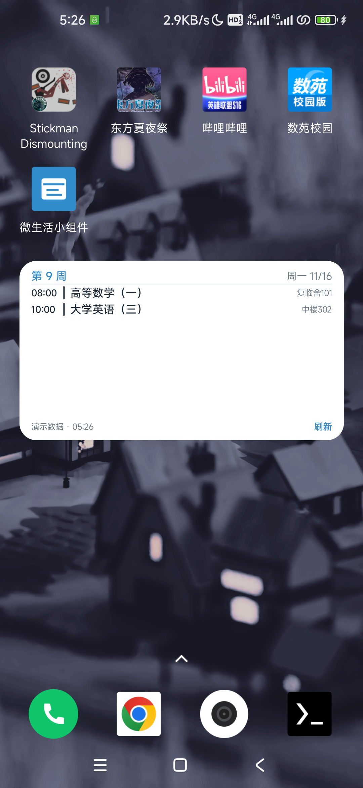
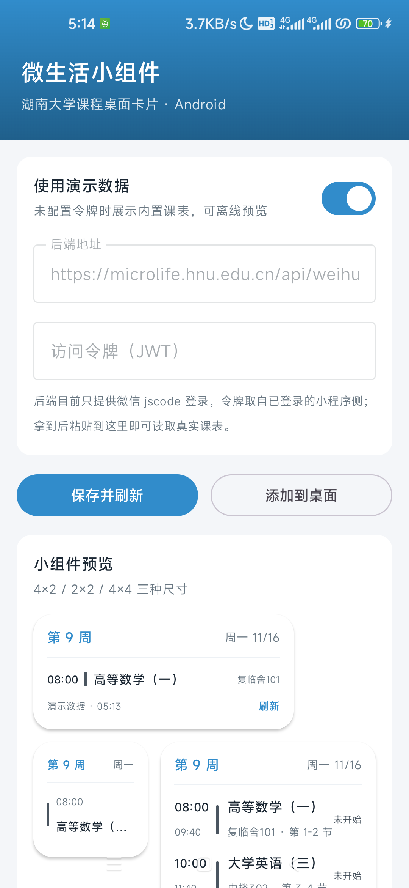

# weihuda!lazer

湖南大学微生活的 Android 桌面小组件。首个交付是**今日课程**小组件：在桌面直接看到当前教学周、今天的课程时间与上课地点，点击进入应用。

<p>
  
  
</p>

## 功能

- **今日课程小组件**：三种尺寸（2×2 / 4×2 / 4×3 / 4×4），按尺寸切换信息密度
  - 2×2：只放大当前或下一节课，并提示“今日共 N 节”
  - 4×2 及以上：逐节展示开始时间、课程名、地点、节次
  - 4×4：额外展示每节课的状态（未开始 / 即将开始 / 上课中 / 已结束）
- **教学周与日期**：周次由学期开始日期整除 7 天得到，与小程序保持一致
- **后台刷新**：WorkManager 每 15 分钟刷新一次，失败时保留当天上一次成功的数据，只提示错误
- **手动刷新**：小组件内的「刷新」立即拉取；点其余区域打开应用
- **演示数据**：未配置令牌时使用内置课表，装好即可看到效果，完全离线

## 数据来源

后端与小程序、移动端 Web 共用同一套接口：`https://microlife.hnu.edu.cn/api/weihuda`

| 用途         | 接口                                                           |
| ------------ | -------------------------------------------------------------- |
| 学期开始日期 | `GET /info/smester`（公开）                                    |
| 课表         | `GET /hdjw/class-table?xn=&xq=`（需要 `Authorization: <JWT>`） |
| 用户信息     | `GET /info/user`（需要 `Authorization: <JWT>`）                |

### 关于登录

后端目前**只提供微信小程序 jscode 登录**（`GET /token?code=`），Android 无法获取 jscode，因此本应用暂时通过「粘贴 JWT」接入真实数据：

1. 在已登录的小程序侧取得 JWT
2. 打开本应用，关闭「使用演示数据」
3. 填入 JWT → 保存并刷新

JWT 使用 Android Keystore 的 AES-256-GCM 加密后存储，应用已关闭 `allowBackup`。

要让 Android 端真正可用，需要在 `weihuda_backend` 增加一个非微信登录入口（学号 + 密码 +
PoW，可选短信二次验证）或让扫码登录直接下发 JWT，详见 [docs/roadmap.md](docs/roadmap.md)。

## 工程结构

```text
core/    纯 Kotlin JVM 模块：接口客户端、课表模型、周次/状态计算、快照与演示数据
widget/  Glance 小组件、WorkManager 刷新、Keystore 令牌存储、快照读写
app/     设置页（Compose Material3）、一键添加到桌面、预览
```

- `core` 不依赖 Android，可以在 JVM 上直接跑单元测试；以后要接 iOS
  WidgetKit 时可直接平移为 KMP 共享模块
- `widget` 只负责“渲快照 / 拉快照”，对 app 暴露 `CourseWidgets` 门面，不泄漏 Glance 类型
- 小组件进程不发请求：`RefreshWorker` 写快照 → `CourseWidget().updateAll()` 触发重组

## 开发

工具链：Gradle 9.9.0（wrapper 自带）、AGP 9.2.1（内置 Kotlin，无需 `kotlin-android` 插件）、Kotlin
2.4.21、JDK 21、compileSdk 36。

AGP 版本受 Android Studio 限制：Studio 2026.1 最高支持 AGP 9.2.1，所以没有继续往上跟。Gradle 必须 ≥ 9.6
（AGP 9.x 的要求），也不能退回 8.x —— Gradle 9.6 起 AGP 8.x 无法启动。

要求 JDK 17+（推荐 21）与 Android SDK 36（`platforms;android-36` + `build-tools;36.0.0` 或更高）。

如果本机只装了 `android-36.1`（Android 16 QPR2），在 `~/.gradle/gradle.properties` 里加
`compileSdkMinor=1`、`buildToolsVersion=36.1.0` 即可，仓库本身仍按标准 `android-36` 构建。

代码缩进统一使用 **tab**（`.editorconfig` 已声明），别用空格重排。

```bash
./gradlew :app:assembleDebug     # 构建 debug 包
./gradlew :core:test             # 领域逻辑单元测试
./gradlew :app:lintDebug         # Lint
adb install -r app/build/outputs/apk/debug/app-debug.apk
```

构建依赖使用阿里云镜像、Gradle 发行版使用腾讯云镜像（`settings.gradle.kts` 与
`gradle/wrapper/gradle-wrapper.properties` 中已配置，官方仓库作为兜底）。

把小组件放到桌面：应用内「添加到桌面」，或长按桌面 → 添加小组件 → 微生活小组件。

## 已知限制

- 后端没有 Android 可用的登录方式，真实数据需要手动粘贴 JWT（见上）
- 部分启动器（如 MIUI）不会使用 `previewLayout`，小组件选择器里显示占位图
- 桌面单元格高度与 dp 不完全对应，行数按声明的响应式尺寸估算

## 许可

[Apache-2.0](LICENSE)
